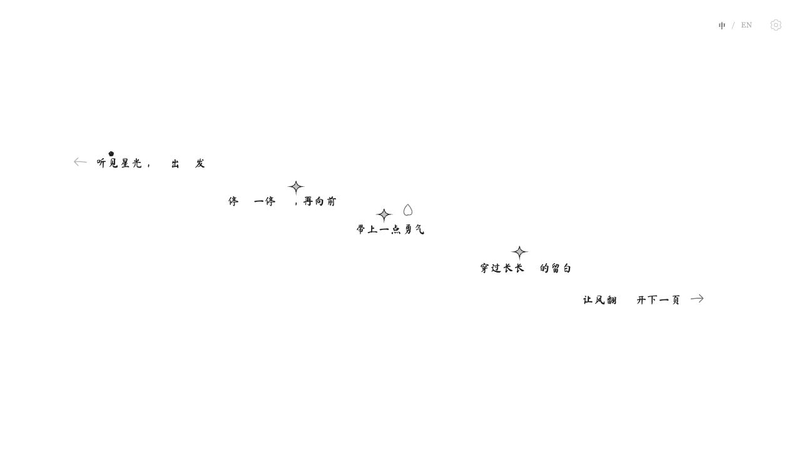
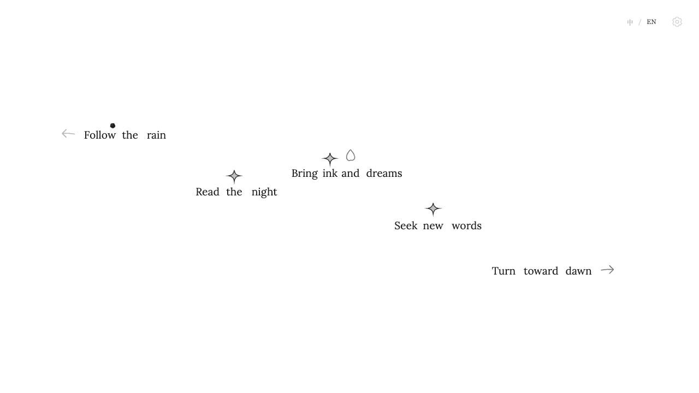
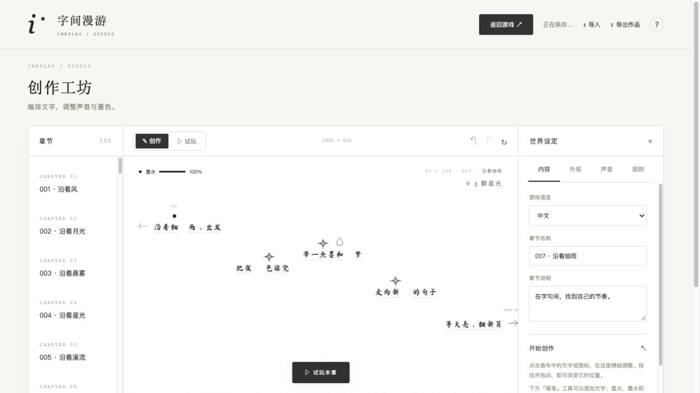

# 字间漫游 · Inkplay

[](https://github.com/wang-zhengxin/inkplay/actions/workflows/pages.yml)

一个以文字为落脚点的水墨小游戏。操控墨点在字句之间跳跃，越过留白，触碰箭头翻开下一页。灵感来自 Casus Liber，以原生 JavaScript、Canvas 和 Web Audio 实现，并提供独立的关卡创作工坊。

**[在线试玩](https://wang-zhengxin.github.io/inkplay/) · [创作工坊](https://wang-zhengxin.github.io/inkplay/editor.html) · [使用指南](docs/GUIDE.md) · [部署方案](docs/DEPLOYMENT.md)**

## 截图介绍

### 中文 · 水墨纸页

打开页面即可游玩。文字在画面中央留白区域从左向右、整体向右下展开；墨点起跳时拉伸，落地时压扁回弹，镜头随跳跃起落。游戏页只保留语言切换和创作入口，操作提示会自动淡出。



### English · 完整单词

主页面「中 / EN」即时切换语言。英文使用本地 Lora 正体，按完整单词绘制与碰撞，保留词间可掉落的空隙。中英文所有关卡片段使用相同字号，长片段自然延伸。



### 创作工坊 · 自定义世界

点击右上角齿轮进入独立页面。拖动文字改变位置，编辑中英文内容、分组与字距；自由设置主题、皮肤、音效和物理规则。内置随机世界生成、试玩、撤销重做和完整作品导入导出。



## 特性

- **100 个双语关卡**：固定种子可复现，创作页更换种子可重新生成整套世界。
- **内容感知的随机排布**：根据中英文实际字宽安排间距，随机分配纵向步幅、回折与少量交叠，保持可跳跃的路线和右下终点。
- **真正的文字平台**：中文按 1–10 字分组；字间、词间空隙参与物理碰撞，墨点可以落下。
- **触碰箭头翻页**：右箭头进入下一关，左箭头返回上一关，左右滑动转场；星光可选收集。
- **自由创作**：调整内容、位置、字号、字距、分组、主题、皮肤、图片和音频；支持最多 200 章、每章 250 个对象。
- **本地素材与存档**：字体随项目打包，默认音效直接合成；作品自动保存在浏览器 IndexedDB，可导出 JSON 备份。
- **纯静态部署**：无需后端或数据库，无第三方运行时依赖；支持 GitHub Pages 和 Nginx。

## 本地运行

需要 **Node.js 22 或更高版本**。无需安装 npm 依赖。

```sh
git clone https://github.com/wang-zhengxin/inkplay.git
cd inkplay
npm start
```

游戏：<http://127.0.0.1:4173/>，工坊：<http://127.0.0.1:4173/editor.html>。macOS 可双击 `启动游戏.command`。端口已占用时运行 `PORT=4174 npm start`。请通过 HTTP 访问，直接双击 HTML 文件无法正确加载 ES modules。

## 操作

| 操作 | 按键 / 入口 |
| --- | --- |
| 左右移动 | A / D 或 ← / → |
| 连续跳跃 | 按住 W / ↑，每次落地继续跳跃 |
| 滑翔 | 下落时松开并重新按住跳跃 |
| 消耗墨水变大 | 按住空格，拾取墨水补充 |
| 重来本关 | R |
| 上一关 / 下一关 | 触碰起点左箭头 / 末尾右箭头 |
| 中文 / English | 右上角「中 / EN」 |
| 设置与创作 | 右上角齿轮或 Esc |

触屏设备显示淡色操作按钮。声音在首次按键或触摸后启用。首尾关卡循环；掉落会重生，R 重来会清除当前关卡的收集进度。

## 创作与存档

在工坊中选择章节，再点击或拖动画布中的对象。右侧「内容 / 外观 / 声音 / 规则」管理关卡与世界设定；「返回游戏」会先保存当前修改。

同一个网站地址的游戏和工坊共享本机存档。GitHub Pages、本地预览和局域网服务器的存档彼此独立；迁移作品请先导出 JSON，再在新地址导入。网站更新会升级未修改的默认关卡布局，保留手工编辑的章节。清理浏览器数据前请导出备份。

示例作品：[中文纸页](examples/paper.inkplay.json)、[英文纸页](examples/english.inkplay.json)。详细限制和编辑操作见 [使用指南](docs/GUIDE.md)。

## 测试与打包

```sh
npm test
npm run build
```

目前包含 47 项测试，覆盖碰撞、字间掉落、连续跳跃、形变、镜头、语言切换、箭头翻关、转场、存档校验和升级保护。实际按键模拟验证四个随机种子的 **800 条中英文路线**能集齐星光并通关。

构建产物位于 `dist/`，包含 HTML、CSS、JavaScript、本地字体和示例作品。站点资源使用相对路径，支持 `/inkplay/` 等子目录。

## 自动部署

[GitHub Actions](https://github.com/wang-zhengxin/inkplay/actions/workflows/pages.yml) 在每次推送到 `main` 后自动执行测试、构建和 GitHub Pages 发布。PR 运行测试和构建，只有 `main` 可发布；也可在 Actions 页面手动运行。

公网地址：<https://wang-zhengxin.github.io/inkplay/>。现有局域网部署：<http://172.22.1.100/>。

完整初始化、发布、回滚及局域网服务器方案见 [部署文档](docs/DEPLOYMENT.md)。

## 项目结构与扩展

```text
.github/workflows/pages.yml   测试与 GitHub Pages 自动发布
scripts/build.mjs            静态网站打包
src/                        游戏、模型、绘制、工坊和存档
assets/fonts/               中文毛笔字体与英文 Lora
examples/                   双语示例作品
tests/                      Node.js 测试
docs/                       使用指南、部署方案和截图
deploy/                     Nginx 配置、systemd 服务与安装脚本
index.html                  沉浸游戏页
editor.html                 独立创作工坊
```

主题在 `src/model.js` 的 `THEMES` 注册；文字分组在 `src/layout.js`，路线排布在 `src/route-layout.js`，关卡内容在 `src/campaign.js`。物理引擎 `src/engine.js` 与 Canvas 绘制 `src/render.js` 独立，方便扩展新主题、素材、关卡和规则。更多模块职责见 [使用指南](docs/GUIDE.md#扩展代码)。

## 字体与致谢

中文使用 Ma Shan Zheng，英文使用 Lora。两款字体采用 SIL Open Font License 1.1，随仓库保留版权和完整许可；详见 [字体说明](assets/fonts/README.md)。游戏玩法灵感来自 Casus Liber。
